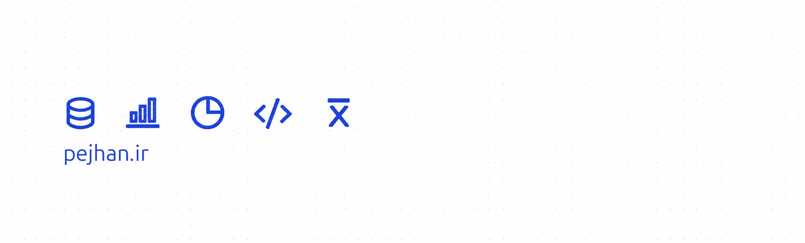

## 📝 Blog

- **[Finding order where there seem to be None](https://www.linkedin.com/pulse/finding-order-where-seem-none-pezhman-aliabadi-gkqif)** — Use foreign-key relationships and recursive SQL to find the order for migrating data between related tables.
- **[Six months with PostgreSQL, after years of SQL Server](https://www.linkedin.com/feed/update/urn:li:activity:7359684286637051905/)** — Observations on working with PostgreSQL after years in the SQL Server ecosystem, with a short comparison video.
- **[Asterisk Risk ✨: Avoid using `*` in your SQL code](https://www.linkedin.com/pulse/asterisk-risk-avoid-using-you-sql-code-pezhman-aliabadi-kkggf)** — How schema changes can quietly break SQL Server views using `SELECT *`, and how explicit columns and schema binding help.

## 🛠️ Side projects

- **[Trash Current Track](https://github.com/Pejhan/quodlibet-trash-current)** — A simple plugin for QuodLibet giving you the ability (or let's say liberty) to move the current playing track to trash using global keyboard shortcuts.
- **[Playlist Shortcuts](https://github.com/Pejhan/quodlibet-playlist-shortcuts)** — Add the current Quod Libet track to playlists with global keyboard shortcuts.
- **[Grabgram](https://github.com/Pejhan/Grabgram)** — A desktop app for downloading Telegram videos, audio, photos, and documents, with resumable downloads and download history.

## 👋 About & contact

I prefer
    Light mode 💡 over Dark mode 🌙, 
    Tweaking 🛠️ over Cracking 🔓,
    pen and paper 🗒️ over cursors and digital screens 🖥️, 
    outsourcing repetitive tasks to agents 🔁, while doing the heavy-liftings myself 🏋️‍♂️.

[GitHub](https://github.com/pejhan) · [LinkedIn](https://www.linkedin.com/in/pejhan) · [Telegram](https://t.me/pejhan)

